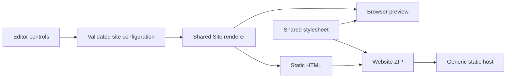

# ADR 001: Shared React rendering for browser static export

## Status

Accepted for the Phase 0 feasibility implementation. Revisit when client-side motion and asset packaging are integrated. This decision does not establish v1 release readiness.

## Context

HowlScene must export a complete static website inside the browser without a remote build server. Essential content must exist in HTML, work without JavaScript, and survive deployment under a nested URL. Preview and export must preserve one authoritative implementation of content semantics.

## Alternatives considered

| Approach                                    | Advantages                                                                          | Costs and risks                                                                                                                                   |
| ------------------------------------------- | ----------------------------------------------------------------------------------- | ------------------------------------------------------------------------------------------------------------------------------------------------- |
| Browser-compatible React static rendering   | Reuses the React renderer; escapes text; emits semantic HTML before any script runs | Adds server-rendering code to the editor export path; browser bundling must be verified; interactive effects need a separate enhancement strategy |
| Portable semantic model and HTML serializer | Small output and explicit HTML control                                              | A second layout implementation can drift from React preview; escaping and accessibility rules need careful centralized design                     |
| Precompiled runtime with a blank HTML shell | Straightforward client application delivery                                         | Essential text depends on JavaScript; fails the no-script acceptance requirement                                                                  |
| Precompiled runtime plus generated HTML     | Progressive enhancement can preserve content while adding motion                    | Requires versioned runtime coordination and lifecycle verification; unnecessary for the first slice                                               |

## Decision

Use `react-dom/server.browser` and `renderToStaticMarkup` in the browser export path. Render the same `Site` component used by the editor preview. Validate unknown input before rendering. Package the HTML and shared stylesheet with JSZip. Use relative stylesheet paths and fixed ZIP entry names.

The initial published site exports no JavaScript. Browser-generated static markup is sufficient for the initial content and anchor navigation. Future animations must enhance the existing HTML and preserve no-script content. They must not introduce a divergent renderer.

## Consequences

Content escaping and semantic structure have one source of truth. The exporter remains independent of private editor components. The static runtime is small because this slice needs no runtime script or external fonts.

The current renderer uses only portable render-time behavior. Browser-only effects must remain outside static rendering. Adding uploads requires an asset manifest, validated image formats, size limits, controlled paths, and resource-lifecycle tests. Rich text requires a portable validated model rather than arbitrary HTML.

The ZIP currently includes `index.html`, `site.css`, and `PUBLISH.txt`. Fixed archive timestamps reduce avoidable nondeterminism. This does not promise byte-identical archives across different dependency builds.

## Verification and exit criteria

Automated checks must edit a value in the browser, download and extract the ZIP, serve the extracted directory through an ordinary HTTP server, and inspect meaningful content with JavaScript disabled. Test root, nested, and GitHub Pages-style project mounts using actual mounted directories. Verify assets and navigation at each mount; changing only a browser URL is insufficient evidence.

Record actual test outcomes and compressed output measurements in milestone evidence. Current test execution and improvements remain in progress; this ADR does not assert final counts or completed acceptance gates.
