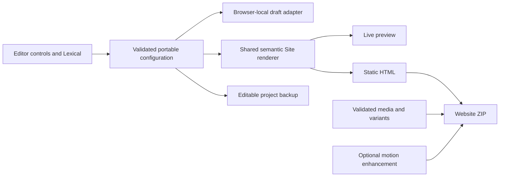

# Architecture and engineering workflow

HowlScene is a development preview of a single-page website editor and reusable renderer. This guide describes implemented boundaries; it does not establish v1 readiness or a deployed service.

## Responsibilities and dependencies

| Boundary              | Owns                                                                                                                         | Why it exists                                                                           |
| --------------------- | ---------------------------------------------------------------------------------------------------------------------------- | --------------------------------------------------------------------------------------- |
| `packages/core`       | Versioned schema, theme and section registries, semantic rendering, portable rich text, image validation, motion enhancement | A consumer can render content without importing editing controls or browser draft state |
| `apps/editor`         | Lexical bridge, guided controls, selection, history, IndexedDB adapter, save feedback                                        | Editing lifecycle and failure recovery do not belong in published websites              |
| `packages/export`     | Project backups, static HTML/CSS/runtime packaging, media paths, notices and publishing instructions                         | Browser export needs validated portable input, not private editor state                 |
| Showcase and examples | Consumer configurations and product presentation                                                                             | Demonstrations must use the same public APIs as other consumers                         |

`parseSite` accepts unknown input and produces normalized schema-version-1 content without mutating the caller. Stable IDs survive reordering. Unsupported versions fail explicitly; version 1 is the first supported format, so no historical migration is claimed. The configuration centralizes layout choices, navigation membership, visibility, image treatment, spacing, width, motion, metadata, and references. A hidden section is omitted from rendered content and navigation.

## Manifest layers and trusted artwork

Theme layers are declarative data referencing an immutable artwork registry. The renderer resolves those references instead of branching on a theme ID, so a fourth theme can provide original inline scenery without editing engine code. Cloning a bundled manifest retains its explicit layers; token-only manifests receive Modern defaults, and an explicit empty list produces no artwork. The canonical [theme layer guide](theme_layers.md) describes bounded layer contracts and the working public API.

Factories remain trusted synchronous application code outside project JSON. Render and export receive the same theme/artwork/section registries; backup reopening requires compatible registries but never deserializes functions. The first trusted custom-section contract is documented in [custom section authoring](custom_sections.md). Arbitrary custom payload schemas, standard-editor chooser integration, arbitrary layouts, broader theme metadata, and external resource collection remain open; this separation does not introduce an executable plugin loader or claim a complete v1 theme system.

## Portable content and headings

Lexical state is translated into `RichDocument`; it is not the canonical public project format. Blocks are paragraphs, headings with stored level 2 or 3, and single-level ordered/unordered lists. Spans carry plain text, bold, italic, and optional validated links. Unsupported nested lists, arbitrary HTML, and custom editor nodes are outside the current serialization contract.

Heading levels express relative document structure. The first visible section owns an `h1`; later sections own `h2`. `Site` passes child `headingLevel` 2 or 3 into rich text and entry rendering. A stored rich heading level 2 therefore renders as `h2` or `h3` according to context, and stored level 3 renders one level deeper. Standalone `RichText` defaults to level 2; standalone entries default to level 3. Custom renderers should honor the supplied child rank. Empty or whitespace-only section headings display the accessible fallback “Untitled section.”

## Drafts, history, and backups

The editor's `DraftStore` boundary exposes `load`, `save`, and `close`; `IndexedDbDraftStore` accepts an injected factory and database name for testing. It writes one validated project record in an atomic transaction. Save success is reported on transaction completion. Database errors reject rather than silently claiming persistence, and connections close on disposal/version change.

Editor history retains 50 previous committed snapshots. New edits clear Redo, identical states do not create steps, and individual text commits can be separate history entries. Undo history, draft persistence, and portable backups are different mechanisms. Restore failure pauses automatic saving to protect existing data; callers must preserve in-memory work and offer backup recovery on quota/storage failures.

Backups use the strict `howlscene-project` envelope, version 1, with embedded supported assets. `importBackup` validates structure and headers; browser callers use `importValidatedBackup` to also decode images before replacement. Custom-theme backups require a compatible developer theme registry. No executable registry implementation is serialized.

## Static export and media

Export reuses `Site` through React static rendering. Essential text exists before JavaScript. CSS and the optional progressive motion runtime ship locally; the editor is unnecessary at runtime. Relative media paths use separate asset directories: `assets/<id>/original.<ext>` and `assets/<id>/w<width>.<ext>`. One helper determines HTML references and ZIP entries, preventing collisions between asset IDs and responsive suffixes. Only media referenced by visible supported sections/entries is packaged.

Uploads inspect PNG/JPEG/WebP header dimensions before decoding, then reencode pixels without original metadata. The normalized base uses at most 1600 pixels on its longest side and generates smaller 480/960-width candidates where appropriate. Browser project acceptance additionally checks decoded dimensions; header validation in Node is not a full image codec. See [contracts](contracts.md) for limits and [ADR 001](../architecture/adr_001_static_export.md) for export alternatives.

## Trust assumptions and lifecycle

Project JSON is untrusted. Exact schemas reject unsupported fields, unsafe paths, references, CSS tokens, and URL schemes. User text is rendered as text rather than imported HTML. SVG uploads and imported JavaScript are unsupported. Theme token registries are validated; component overrides are trusted developer code and can introduce unsafe behavior or external requests if misused. Custom resource discovery and bundling are not automatic.

`enhanceSite(root)` progressively adds motion and returns cleanup. Dispose it when replacing the rendered root. Reduced-motion preference and the manual disable control preserve access to content. Scenery is decorative. Token contrast checks do not establish contrast over arbitrary uploaded imagery, nor do automated accessibility tests establish WCAG conformance. See [privacy](../architecture/privacy.md) and the security policy for remaining review boundaries.

## Build, verification, and release

Use the lockfile with `npm ci`. `npm run build` prepares the runtime and production/prerendered app outputs. `npm run build:sdk` and `npm run build:export` produce the two package artifacts. `npm run sdk:check` packs them and verifies a consumer outside the workspace; workspace imports alone are insufficient evidence of reusable packaging.

Develop new production behavior through a genuine failing test, minimal implementation, refactor, and fresh verification. `npm run check` combines formatting, lint, build/type checking, unit coverage, browser tests, SDK consumption, and license checks. CI additionally runs vulnerability auditing. Use `npm audit --audit-level=moderate` explicitly during release review. Check current script output rather than assuming any command passed.

Before release, serve extracted ZIPs at real root and nested mounts, inspect no-script content, test media and motion cancellation, complete independent review, and verify current coverage, performance, accessibility, dependency/asset notices, and the nontechnical workflow. Publishing credentials and branch protections are separate operational requirements. Multipage content, arbitrary canvas placement, accounts, cloud sync, full 3D, and a marketplace remain deferred; no elaborate plugin runtime is implemented for them.
